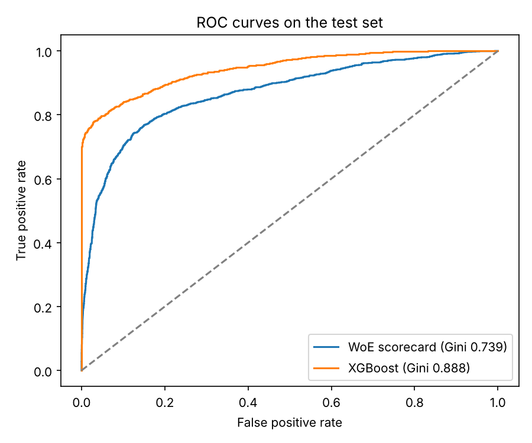
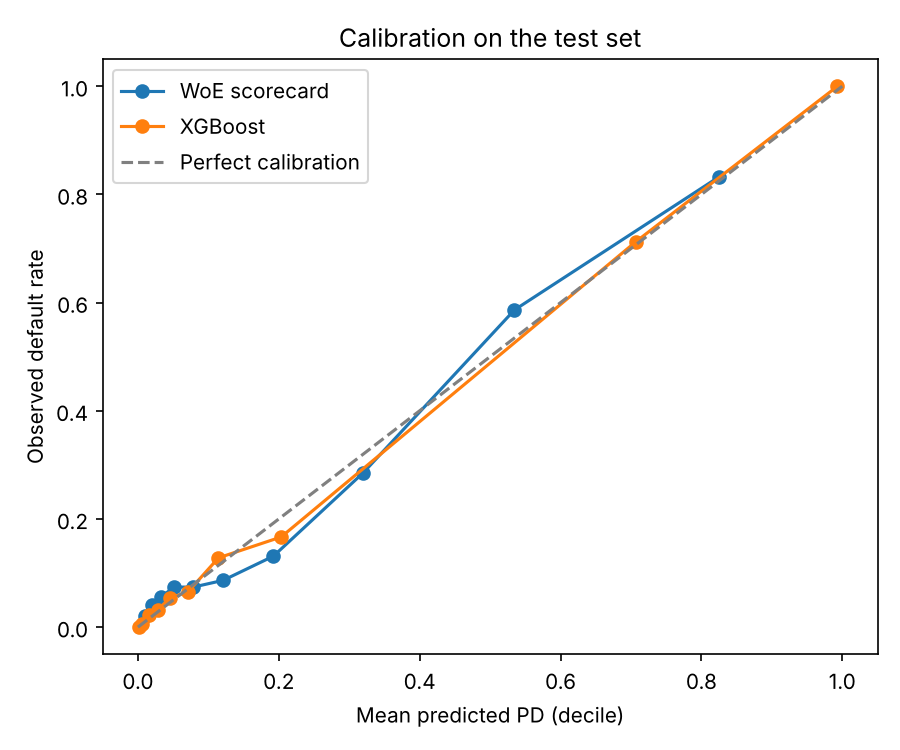
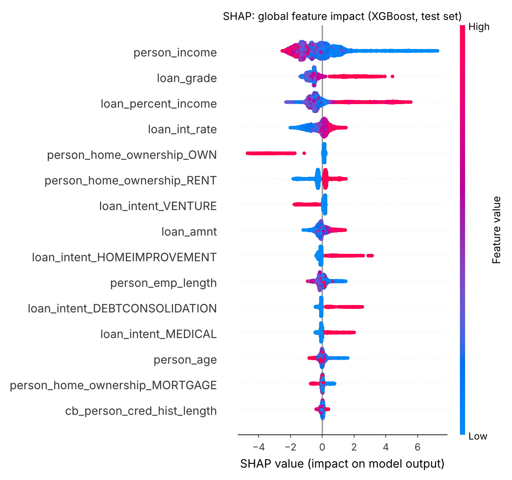
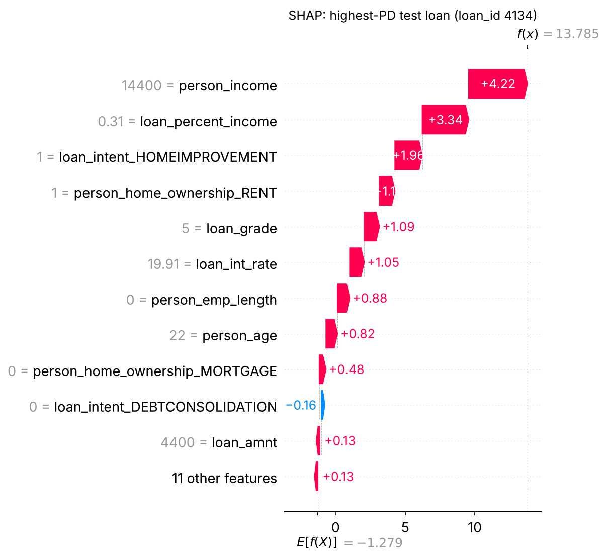
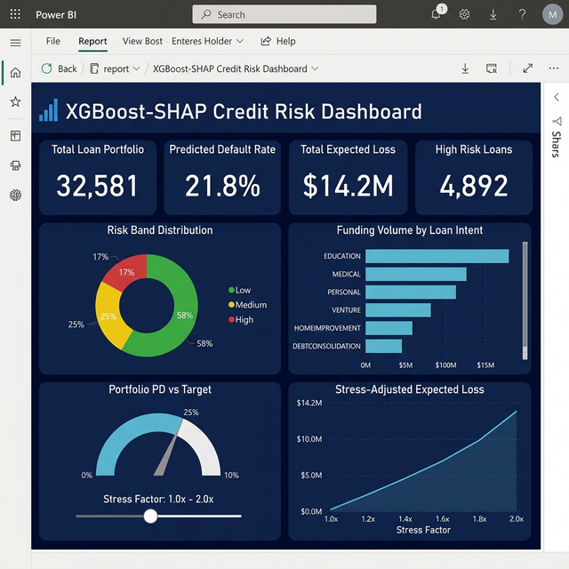

# Credit Risk PD Model: WoE Scorecard vs XGBoost with SHAP

An end-to-end probability-of-default (PD) project on 32,581 consumer loans:
data cleaning, a Weight-of-Evidence logistic scorecard as the benchmark, an
XGBoost challenger explained with SHAP, validation metrics used in credit
risk (Gini, KS, calibration, PSI), and a SQL Server and Power BI reporting
layer with expected loss.

The full validation write-up, including limitations, is in
[MODEL_VALIDATION.md](MODEL_VALIDATION.md).

## Results (held-out test set, 6,483 loans)

| Metric | WoE scorecard (benchmark) | XGBoost (challenger) |
| :--- | ---: | ---: |
| AUC | 0.869 | 0.944 |
| Gini | 0.739 | 0.888 |
| KS | 0.618 | 0.750 |
| Brier score | 0.102 | 0.053 |
| Mean PD vs observed default rate | 21.8% vs 21.9% | 21.9% vs 21.9% |

- XGBoost 5-fold cross-validated AUC: 0.948 (std 0.003).
- Without the lender-assigned variables (loan grade, interest rate),
  XGBoost still reaches AUC 0.904.
- **Read with care:** this public dataset is much easier to separate than a
  real lending book and has no dates, so there is no out-of-time test. See
  the limitations in the validation note.





## Explainability (SHAP)

Global impact of each feature on the XGBoost model:



Explanation for the single highest-PD loan in the test set:



## Method

1. **Cleaning** (`data_prep.py`): drop 165 duplicate rows and 5 applicants
   aged over 100; set 2 impossible employment lengths to missing; impute
   missing values with training-set medians (interest rate by loan grade),
   keeping missing-value flags.
2. **Split:** stratified 80/20. XGBoost early stopping uses a validation
   split from the training data; the test set is only used for final figures.
3. **Benchmark scorecard** (`scorecard.py`): quantile binning, WoE
   transform, Information Value table (`outputs/information_value.csv`),
   logistic regression, and points scaling (600 points at 50:1 odds,
   20 points to double the odds) in `outputs/scorecard_points.csv`.
4. **Challenger** (`credit_risk_model.py`): XGBoost with ordinal loan grade
   and one-hot categoricals, early stopping, 5-fold CV, and a sensitivity
   run without lender-assigned variables.
5. **Validation** (`metrics.py`): AUC with bootstrap interval, Gini, KS,
   Brier score, decile calibration and PSI.
6. **Reporting:** `predictions.csv` (test-set PDs, scores and risk bands,
   keyed by `loan_id`) loads into SQL Server; `create_views.sql` adds
   expected loss (PD × 45% LGD × loan amount) for Power BI.

## Power BI dashboard



*Screenshot from the first version of the project, before the model was
rebuilt; figures on it will differ from the table above. Measures and layout
are documented in [power_bi_metrics.md](power_bi_metrics.md).*

## Project structure

```
├── credit_risk_dataset.csv   # Raw Kaggle data (32,581 loans)
├── data_prep.py              # Loading, cleaning rules, imputation, encoding
├── eda.py                    # Exploratory analysis -> figures/
├── scorecard.py              # WoE binning, IV, logistic scorecard, points
├── metrics.py                # Gini, KS, PSI, calibration, bootstrap CI
├── credit_risk_model.py      # Trains both models, validation, SHAP, outputs
├── predictions.csv           # Test-set predictions for SQL / Power BI
├── outputs/                  # metrics.json, IV table, points, calibration
├── figures/                  # All plots
├── setup_database.sql        # SQL Server tables
├── push_to_sql.py            # Loads loans and predictions into SQL Server
├── create_views.sql          # Reporting view with expected loss
├── power_bi_metrics.md       # DAX measures and dashboard layout
├── MODEL_VALIDATION.md       # Validation note and limitations
└── tests/                    # pytest checks for cleaning, leakage, metrics
```

## How to run

```bash
git clone https://github.com/Famulkalam/xgboost-shap-credit-risk.git
cd xgboost-shap-credit-risk
pip install -r requirements.txt

python eda.py                 # plots in figures/
python credit_risk_model.py   # models, metrics and predictions (about 30 seconds)
pytest -q                     # 9 tests
```

Optional SQL step: run `setup_database.sql`, copy `.env.example` to `.env`
with your SQL Server details, run `python push_to_sql.py`, then run
`create_views.sql` and connect Power BI to `dbo.vw_LoanRiskSummary`.

## Data

[Credit Risk Dataset](https://www.kaggle.com/datasets/laotse/credit-risk-dataset)
on Kaggle. The file is included here for reproducibility; check the Kaggle
page for its terms before reusing it elsewhere.

## Author

Famul Kalam, MSc Business Analytics, University of Edinburgh.
[LinkedIn](https://www.linkedin.com/in/famulkalam)
