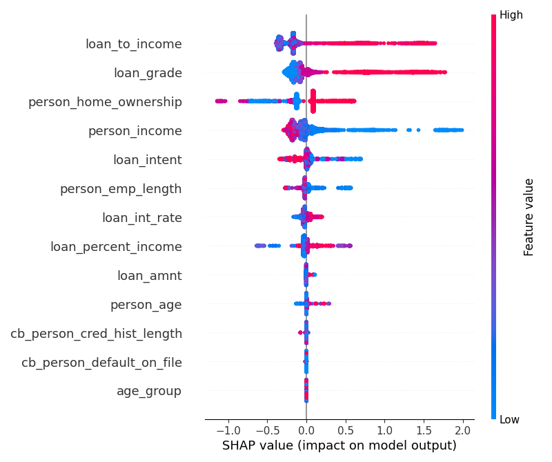
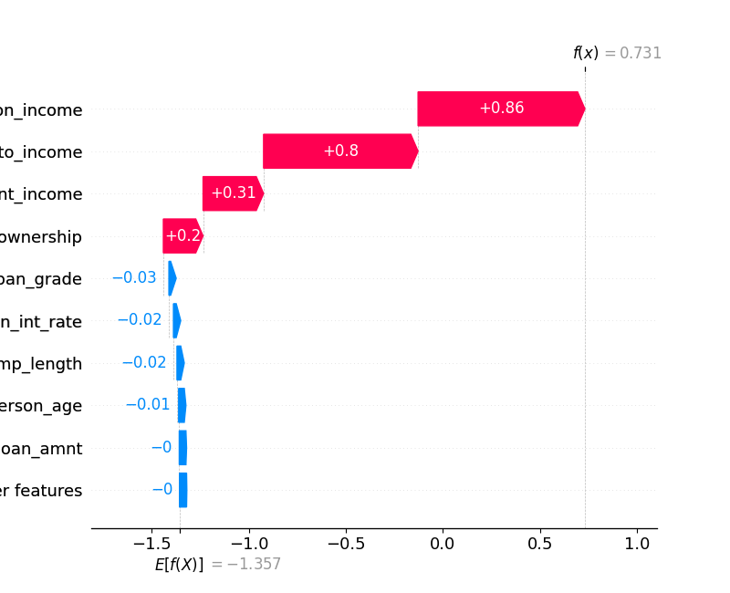

# 🏦 XGBoost-SHAP Credit Risk Scorecard

An end-to-end **Credit Risk ML Pipeline** — from raw loan data through model training, explainability, database storage, and business intelligence dashboarding.

[](https://python.org)
[](https://scikit-learn.org)
[](https://shap.readthedocs.io)
[](https://www.microsoft.com/en-us/sql-server)

---

## 🏗️ Architecture

```
┌──────────────┐     ┌───────────────────┐     ┌──────────────────┐     ┌──────────────┐
│  Kaggle CSV  │────▶│  Python / ML      │────▶│  SQL Server      │────▶│  Power BI    │
│  32,581 rows │     │  HistGBT + SHAP   │     │  (Docker)        │     │  Dashboard   │
└──────────────┘     └───────────────────┘     └──────────────────┘     └──────────────┘
     Data               Model & XAI             Storage & Views         Business Intel
```

---

## 📊 Model Performance Scorecard

| Metric | Train | Test |
|:---|:---:|:---:|
| **Accuracy** | 0.9365 | 0.9323 |
| **AUC-ROC** | 0.9793 | 0.9749 |
| **Precision** | — | 0.9280 |
| **Recall** | — | 0.7606 |

> **Overfitting Check**: Train–Test AUC gap = **0.0044** → Model is **robust** with consistent generalization.

---

## 🔍 Explainable AI (SHAP)

### Global Feature Importance


### Individual Loan Explanation (Waterfall)


> Each bar shows how a single feature **pushes the prediction** toward default (red) or non-default (blue). This provides per-loan transparency for regulators and risk officers.

---

## 📈 Power BI Dashboard

The project includes a **3-page Power BI dashboard** with:
- **Executive Overview** — Total Funded Volume, Predicted PD, Expected Loss, Risk Band distribution
- **Risk Segmentation** — Income vs Loan scatter (color = PD), Grade × Age heatmap
- **Stress Testing** — What-If parameter to scale PD by 1.0×–2.0× and see impact on Expected Loss

> 📸 *Add your Power BI screenshot here after exporting from Power BI Desktop.*

---

## 🗂️ Project Structure

```
├── credit_risk_dataset.csv     # Raw Kaggle dataset (32,581 loan records)
├── eda.py                      # Exploratory Data Analysis + plots
├── credit_risk_model.py        # HistGradientBoosting training + SHAP
├── push_to_sql.py              # Automated Python → SQL Server pipeline
├── setup_database.sql          # SQL Server schema (Loans + LoanPredictions)
├── update_predictions.sql      # Expected Loss calc + Power BI view
├── power_bi_metrics.md         # DAX measures & dashboard layout guide
├── predictions.csv             # Model output with risk bands
├── requirements.txt            # Python dependencies
├── .env.example                # Template for database credentials
└── *.png                       # EDA plots + SHAP visualizations
```

---

## 🚀 Quick Start

### 1. Clone & Install
```bash
git clone https://github.com/Famulkalam/xgboost-shap-credit-risk.git
cd xgboost-shap-credit-risk
pip install -r requirements.txt
```

### 2. Run EDA
```bash
python eda.py
```
Generates `default_distribution.png`, `key_features_boxplots.png`, and `correlation_heatmap.png`.

### 3. Train Model & Generate SHAP
```bash
python credit_risk_model.py
```
Outputs `predictions.csv` and all SHAP plots.

### 4. Push to SQL Server (Optional)
```bash
# First, copy .env.example to .env and fill in your credentials
cp .env.example .env
# Edit .env with your SQL Server password
python push_to_sql.py
```

### 5. Connect Power BI
Open Power BI Desktop → **Get Data → SQL Server** → connect to your Docker instance → import `dbo.vw_LoanRiskSummary`.

---

## 🔐 Security

- Database credentials are loaded from environment variables (`.env` file)
- `.env` is excluded from version control via `.gitignore`
- See `.env.example` for the required configuration template

---

## 📝 License

This project is for educational and portfolio purposes.
